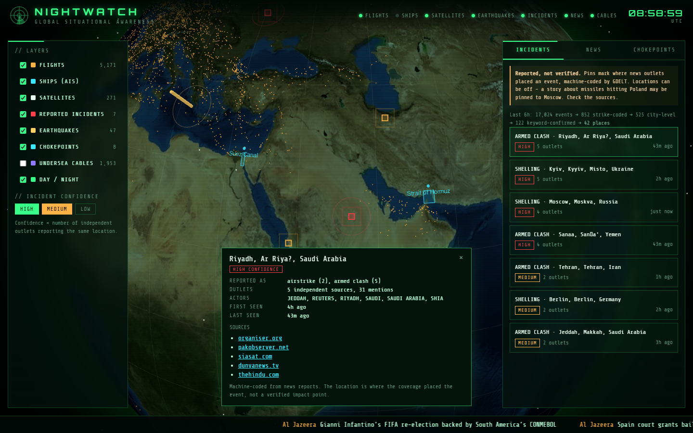

# NIGHTWATCH

A live open-source intelligence globe. Flights, ships, satellites, earthquakes,
reported strikes, public CCTV, YouTube live cams and undersea cables on one 3D globe, built only
from public data feeds.

  



## Layers

| Layer | Source | Refresh |
|---|---|---|
| Flights | [OpenSky Network](https://opensky-network.org) ADS-B, falling back to an [adsb.fi](https://adsb.fi) regional sweep where OpenSky is unreachable | 2 min |
| Aircraft search & tracking | Find a plane by ticket flight number (`6E7251`, translated to the broadcast `IGO7251`), callsign, registration or ICAO hex, or list an airline (`6E`, `UAE`) ([adsb.fi](https://adsb.fi)), then follow it live with a trail | 10 s |
| Ships | [aisstream.io](https://aisstream.io) AIS websocket | live |
| Satellites | [CelesTrak](https://celestrak.org) TLEs, propagated in-browser with satellite.js | every 2 s |
| Earthquakes | [USGS](https://earthquake.usgs.gov) M2.5+ feed | 5 min |
| Reported incidents | [GDELT 2.0](https://www.gdeltproject.org) event stream, filtered (see below) | 10 min |
| News | BBC, Al Jazeera, DW, France 24, The Guardian, NPR RSS | 5 min |
| Public CCTV | ~8,400 cameras: TfL (London clips), Caltrans (California live HLS), DriveBC (British Columbia), Fintraffic (Finland), NZTA (New Zealand), HK Transport Dept, LTA Singapore, and ~1,000 [Windy](https://api.windy.com/webcams) webcams worldwide | live / 30 s stills |
| YouTube live cams | 37 curated 24/7 landmark streams (Times Square, Shibuya, Venice, Kilauea...), played via the official embed; re-validated through oEmbed every 6h so dead streams drop out | live |
| Undersea cables | [Submarine Cable Map](https://www.submarinecablemap.com) | daily |
| Day / night | Computed subsolar point, blended in a custom globe shader | 1 min |
| Street imagery | [Esri World Imagery](https://www.esri.com) tiles once zoomed in to city level | on zoom |

**CCTV** uses official traffic and tourism cameras only. Sites that stream
unsecured private cameras are deliberately excluded. About 8,400 cameras are
drawn as particles. A tap is matched to the nearest camera within 14px on
screen, because a km radius would have to scale with zoom. Zoomed in, live
thumbnails appear, greedily spaced so they don't stack. California streams
play live in-browser via hls.js and are torn down when the card closes.
Windy's worldwide set comes from its map-clusters endpoint as a 12×16 grid of
tiles (its per-zoom box limits), locations only and cached 6h. Images are
fetched per camera on demand, because their tokens expire after ~10 minutes.

The **chokepoint monitor** tracks vessel counts and direction of travel through
Hormuz, Bab-el-Mandeb, Suez, Singapore, Panama, Gibraltar, Dover and the Cape
of Good Hope, and keeps a 24h trend. When traffic through Hormuz or the Red Sea
drops while the Cape count rises, ships are being rerouted around Africa.

## How the incident layer stays honest

GDELT machine-codes world news into events with a location and a source URL
every 15 minutes. Raw, it's too noisy to plot. In a single 15-minute file the
"use conventional military force" code was attached to an F1 race report, a
motorcycle accident and a murder trial. Each event goes through:

1. **Strike-specific CAMEO codes**: aerial weapons, bombings, artillery, armed clashes
2. **City-level geocodes only**: country centroids aren't locations
3. **Whole-word conflict keyword in the source URL**: `war` used to match "toward"
   and "software", and `strike` matched a student walkout
4. **Clustering by location**, with confidence set by the number of
   *independent outlets* rather than raw mention counts

On a typical 6-hour window that's roughly 17,000 events → 850 strike-coded →
520 city-level → 120 keyword-confirmed → ~40 places. Low-confidence
(single-outlet) places are hidden by default. State-affiliated outlets are
labelled, not removed.

Pins mark where coverage placed an event, not verified impact points. GDELT
geocodes the city an article mentions, so a story about missiles landing in
Poland can end up pinned to Moscow. The UI says this next to every pin.

## Run it

```bash
pip install -r requirements.txt
cp .env.example .env          # optional: free aisstream.io (ships) and Windy (webcams) keys
uvicorn app.main:app --port 8000
```

Open http://localhost:8000.

```bash
python -m pytest              # 43 tests: parsers, filters, clustering, chokepoint maths, camera feeds, flight fallback
```

## Layout

```
app/
  main.py              FastAPI app, one endpoint per layer
  live/                live map feeds (flights, ships, satellites, incidents, ...)
  recon/               domain / username recon modules (UI tab in progress)
  static/              globe UI - plain ES modules, no build step
tests/
```

## Notes

- Every upstream call goes through a TTL cache. Concurrent requests share one
  in-flight fetch, which keeps OpenSky's anonymous tier (~100 global snapshots
  a day) from running out.
- OpenSky doesn't answer requests from many cloud hosts. When it fails, the
  flights layer switches to adsb.fi's open API. That API only returns
  aircraft within 250 nm of a point, at 1 request a second, so a background
  task sweeps 151 overlapping circles over the busy airspace (about 3
  minutes per pass). The sweep only runs while someone has the map open.
- Satellite altitude is log-compressed for display. At true scale,
  geostationary satellites would sit behind the camera.
- AIS is self-reported and receiver coverage is mostly coastal. Naval vessels
  usually don't transmit.
- Everything is passive: public feeds and APIs only. Nothing here scans or
  probes a target.
